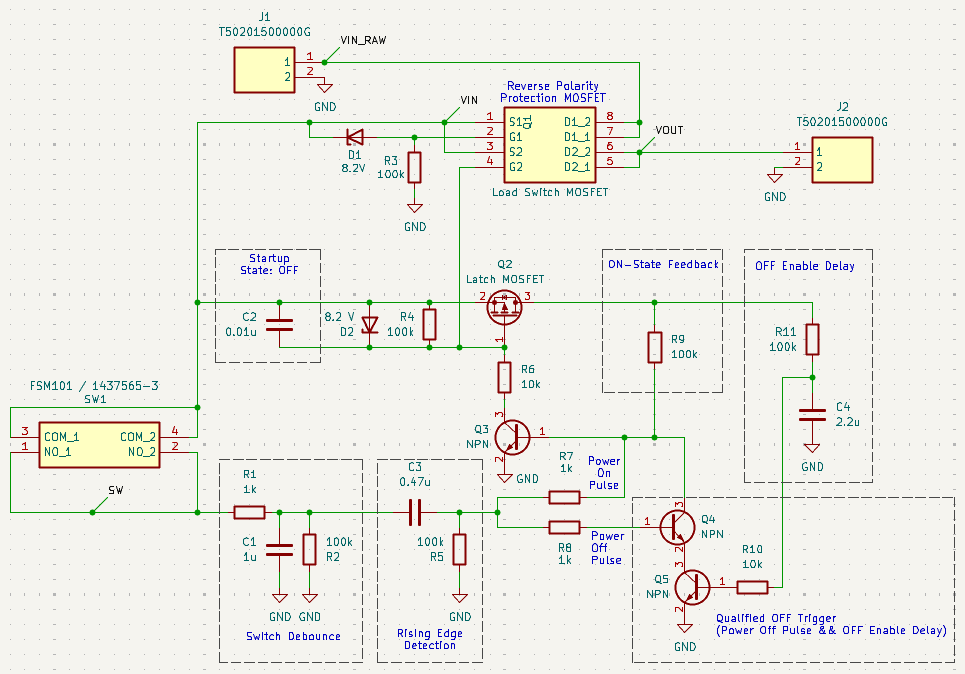
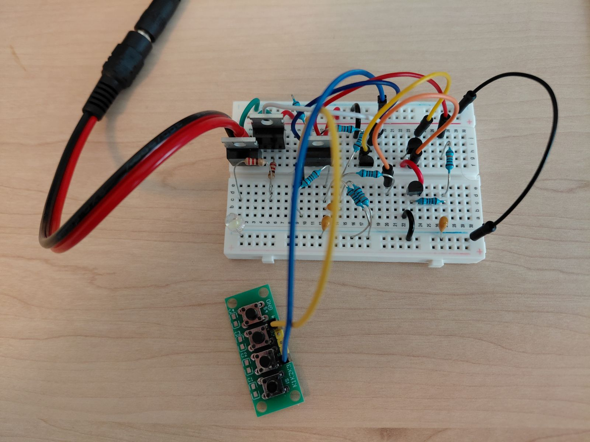

# Push-Button Power Switch

A discrete, high-side MOSFET power switch controlled by a single momentary pushbutton. Designed for battery-powered electronics without requiring a microcontroller or dedicated power-management IC.

## Overview

This circuit was developed as part of a small robotics project where I wanted to replace a mechanical power switch with a momentary pushbutton.

The goal was a simple circuit that could toggle power with a short button press, consume minimal power when switched off, and change state at most once per press, regardless of how long the button was held.

Although this sounds straightforward, I found that many existing discrete power-latch designs were surprisingly finicky. Some were clever and used very few components, but were difficult to understand or sensitive to timing. Others behaved unexpectedly when subjected to rapid button presses or when the button was held down too long, sometimes toggling the power state unintentionally. I wanted a circuit that behaved predictably, even when the button wasn't operated exactly as intended.

This repository contains the KiCad schematic, including the simulation components needed to test the circuit directly in KiCad's simulator.

## Features

- Single momentary pushbutton for ON/OFF control
- Short press toggles power state
- Debounced input to prevent unintended toggling
- Predictable behavior during rapid presses and extended button holds
- No microcontroller or firmware required

## How It Works

The circuit consists of several functional stages:

1. **Startup State:** Keeps the circuit switched off when power is first applied.
2. **Switch Debounce:**  Filters mechanical switch bounce to prevent unintended toggling.
3. **Button Press Detection:** Generates a pulse on the rising edge of a button press.
4. **Power-On Pulse:** Provides the initial pulse needed to activate the MOSFET latch before the ON-state feedback takes over.
5. **ON-State Feedback:** Maintains the latch after the button is released.
6. **OFF Enable Delay:** Prevents the initial button press from immediately switching the circuit off. This delay must be comfortably longer than the Power-On Pulse.
7. **Qualified OFF Trigger:** Releases the latch on a subsequent button press, once the OFF Enable Delay has elapsed.
8. **Load Switch:** Controls power delivery using a separate MOSFET, preventing capacitive loads from interfering with the latch.

See the schematic for component values and connections.

## Design Files

The project was created using KiCad 10.0.6.

| File | Description |
|---|---|
| [push-button-power-switch.kicad_sch](hardware/push-button-power-switch.kicad_sch) | KiCad schematic |
| [push-button-power-switch.kicad_pro](hardware/push-button-power-switch.kicad_pro) | KiCad project configuration |

The schematic includes simulation sources and a simulated load for testing the switching behavior.

## Simulation and Testing

The circuit was developed through simulation and breadboard experimentation. Simulations were used to explore switching behavior across different supply voltages and load conditions, while breadboard testing confirmed basic operation.

Simulation scenarios include:

- Short button presses
- Repeated button presses
- Startup and shutdown behavior
- Different supply voltages
- Resistive and capacitive loads

The circuit was also assembled on a breadboard to verify its operation with a physical momentary pushbutton.

*Breadboard prototype of the push-button power switch, with an additional MOSFET for reverse-polarity protection not shown in the reference schematic.*

## Limitations

The 5–25 V input range has not been fully validated in physical hardware. Select components appropriate for your intended operating voltage and load current, paying particular attention to MOSFET gate-source voltage limits, power dissipation, and capacitor voltage ratings.

## License

Hardware design files are licensed under the CERN Open Hardware Licence Version 2 – Permissive (CERN-OHL-P-2.0). See [LICENSE](LICENSE).
